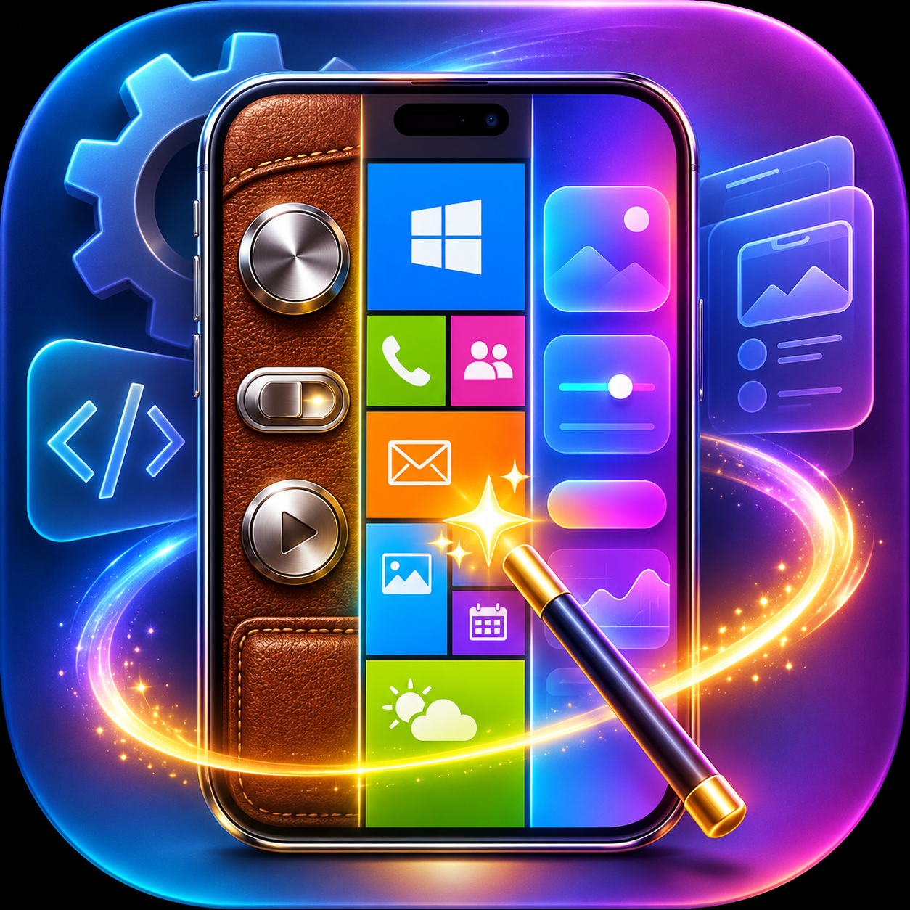

<p align="center">
  
</p>

<h1 align="center">app-utility-prompts</h1>

<p align="center">A <a href="https://claude.com/claude-code">Claude Code</a> skill with ready-made prompts to fully redesign native apps (Android, iOS, Flutter, React Native, desktop).</p>

## Commands

| Command | Aliases | What it does |
|---|---|---|
| `/app-utility-prompts restyle` | `ristrutturazione`, `redesign`, `grafica` | Full graphic rebuild of the app: nicer look, polished animations, better usability. No questions unless asked. |
| `/app-utility-prompts skeumorphism` | `skeuomorphism`, `skeumorfismo`, `skeu` | Full redesign in skeuomorphic style. Asks first whether you want screenshots of the result, and whether to replace the current design or let app users pick the style. |
| `/app-utility-prompts modern-ui` | `modernui`, `metro`, `windows-phone`, `wp` | Full redesign in Modern UI (Windows Phone / Metro) style. Asks first whether you want screenshots of the result, and whether to replace the current design or let app users pick the style. |
| `/app-utility-prompts help` | no argument, `?`, `lista` | Shows the command list. |

### Replace or let users choose

Before starting, `skeumorphism` and `modern-ui` ask whether to:

- **Replace** the current design with the new style, or
- **Add a style switch**, so app users choose between the current design and the new style. The switch goes in the app's settings, or in another fitting place if the app has no settings screen.

Extra text after the command is passed on as an extra instruction, e.g. `/app-utility-prompts skeu only the home screen`.

The prompts themselves are in Italian (see [SKILL.md](SKILL.md)); Claude answers in the language you use.

### What every prompt respects

- Works on a dedicated branch, so the old design can be restored at once.
- No commit, push or release until you approve the result.
- Uses a ChatGPT image tool (e.g. a `chatgpt-image` MCP server) for textures, icons and backgrounds, only if it is configured and actually needed.
- Screenshots go to Telegram if configured, else email, else they are attached in the session.

## Install

Clone into your personal Claude Code skills folder:

```bash
git clone https://github.com/carellice/app-utility-prompts ~/.claude/skills/app-utility-prompts
```

Update later with:

```bash
git -C ~/.claude/skills/app-utility-prompts pull
```

## Customize

Edit `SKILL.md`: each prompt is a `## Prompt: <command>` section, and the alias table at the top maps commands to prompts. Add a row and a section to add a new preset.

## License

[MIT](LICENSE)
